# Hi, I'm Mike 👋

Systems thinker and project manager — I break big problems into small, working pieces.

<!-- START cool-readme cards -->
<picture>
  <source media="(prefers-color-scheme: dark)" srcset="https://raw.githubusercontent.com/Zelray/Zelray/cards/summary-dark.svg">
  
</picture>
<picture>
  <source media="(prefers-color-scheme: dark)" srcset="https://raw.githubusercontent.com/Zelray/Zelray/cards/languages-dark.svg">
  
</picture>
<picture>
  <source media="(prefers-color-scheme: dark)" srcset="https://raw.githubusercontent.com/Zelray/Zelray/cards/contributions-dark.svg">
  
</picture>
<picture>
  <source media="(prefers-color-scheme: dark)" srcset="https://raw.githubusercontent.com/Zelray/Zelray/cards/weekly-dark.svg">
  
</picture>
<!-- END cool-readme cards -->
